# Predicting Forest Leaf Area from Satellites

*An end-to-end account of `wp0` → `s1` → `s7` → `s8`, written for a reader who is not a
remote-sensing specialist. Every number here comes from the `FINDINGS.md` file in the
package that produced it.*

## What we were trying to do

A forest's **leaf area index** (LAI) is how many square meters of leaf sit above each
square meter of ground. It drives how much carbon the forest takes in and how much water
it gives off.

Measuring it means walking to a plot with an instrument. Harvard Forest has done that at a
grid of small plots since 1998, a few times a year. Satellites pass every few days and see
the whole forest at once — but they only see color.

**The question: can we turn the satellite's color into the ground crew's number?** If yes,
you get leaf area every few days instead of a few times a year, and everywhere instead of
at 46 points.

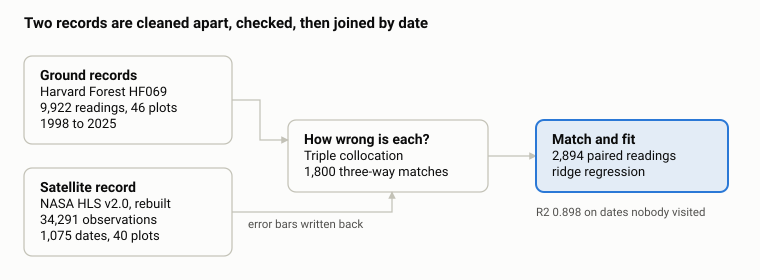

*how the project fits together · 4 stages*

## The two kinds of data

**The ground measurement** comes from an optical instrument held under the canopy. It looks
up and measures how much sky is blocked. It cannot tell a leaf from a branch, so what it
really measures is *plant* area index (PAI), not leaf area index. That matters later.

**The satellite measurement** is reflectance — how bright the forest is in each color band.
Leaves absorb red light and reflect infrared strongly, so the gap between those two bands
tracks greenness. Three standard combinations are the model's inputs:

- `NDVI = (NIR − red) / (NIR + red)`
- `EVI2 = 2.5 × (NIR − red) / (NIR + 2.4 × red + 1)`
- `NIRv = NDVI × NIR`

The two also do not look at the same patch of ground:

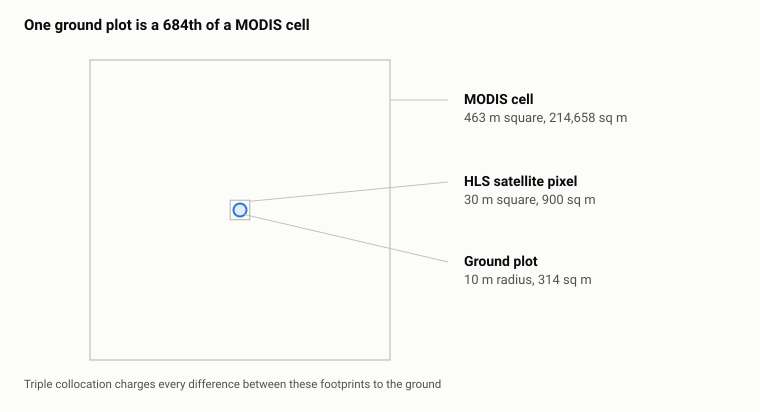

*the three footprints, drawn to scale*

## Getting the ground data

The source is the Harvard Forest archive dataset **HF069**. Nothing is downloaded — the
file sits on disk and is MD5-hashed, so a later run fails loudly if it changed underneath
us.

**Why bother.** If the local copy of HF069 were ever replaced — archives do revise datasets
— every number below would shift and nothing in the code would notice. The fingerprint
turns that into an error instead: `python -m wp0 verify` re-checks each input against what
the stage actually consumed, and names any file that moved.

The cleaning does four things:

- **Checks plot names against the official roster.** 55 labels appear in the raw file; only
  46 are real EMS-tower plots. The other 9 hold 122 rows between them, written to a rejects
  file rather than silently dropped.
- **Collapses duplicates.** 103 rows share a date and plot with another row. These are real
  repeat measurements, so they are averaged into one row that records how many went in.
- **Groups visits into campaigns.** Visits within 3 days of each other count as one field
  campaign. This matters enormously for honest scoring later.
- **Renames the column.** The archive calls it LAI; the archive's own metadata says plant
  area index.

Result: **9,922 clean rows across 46 plots, 1998-04-15 to 2025-11-20, over 288 campaigns.**
Nothing from 2000 to 2004 — we read the raw file to check, and that gap is real in the
archive, not something our cleaning introduced.

**Turning PAI into LAI.** The instrument counts branches as leaves. In winter a deciduous
forest has no leaves, so whatever it reads then is the woody part. Subtract each plot's own
minimum and what remains is roughly leaf:

```
LAI = PAI − (that plot's minimum PAI)
```

This is a defensible estimate, not a measurement. The foundation package ships four
variants and deliberately picks none; the model uses the per-plot subtractive one. Every
result downstream inherits that choice.

## Getting the satellite data

The published Harvard Forest satellite record stops in 2020, so we rebuilt it.

**Source.** NASA's **HLS v2.0** (Harmonized Landsat Sentinel-2) — Landsat and Sentinel-2
surface reflectance on a common 30 m grid, tile T18TYN. Seven AppEEARS point-sample
requests through NASA Earthdata, split into non-overlapping date ranges: four Landsat
bundles covering 2013–2026 and three Sentinel-2 bundles covering 2015–2026. Each uploaded
the same 95 points — the centers of the 95 pixels the 40 grid plots physically touch.
Uploading pixel *centers* rather than an area is what preserves pixel identity through a
CSV export.

**Which bands.** Red is `B04` on both satellites. Near-infrared is `B05` on Landsat but
`B8A` on Sentinel-2 — deliberately the narrow band, never the broad `B08`. The two
satellites also use the same band *names* for different physical quantities (Landsat's
`B10` is temperature in °C; Sentinel-2's `B10` is reflectance), which is why there is no
generic loop over bands anywhere in the code.

**Throwing out bad pixels.** Every observation carries a quality mask. We drop fill values,
cloud, cloud shadow, adjacent-to-cloud, snow, water, anything outside 0–1 reflectance, and
the provider's highest aerosol level.

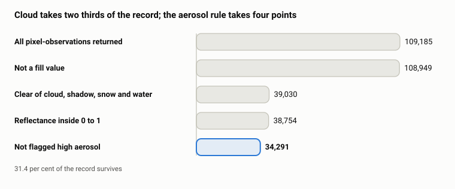

*what survives quality masking · 5 stages*

Cloud is what costs the record. The high-aerosol rule removes a further 4 points on top of
that — but it is still right to enforce: 1,605 observations carry physically impossible
*negative* red reflectance, and 98.8% of those are flagged high-aerosol. Masking happens
**before** indices are computed, so a masked pixel produces no number rather than a wrong
one.

Aggregated from 95 pixels up to 40 plots, the rebuilt record covers **1,075 dates from
2013-04-16 to 2026-08-04**, against 261 dates in the published version.

## Checking the data

Three independent checks, none of which assume the satellite is right.

**A fake satellite image, built to be hostile.** Testing the real pipeline would need NASA
credentials and a download every time, so the code writes its own satellite file to disk
and tests against that. It is not meant to look realistic — it is meant to carry every
defect the real files have. The main one is the scale factor.

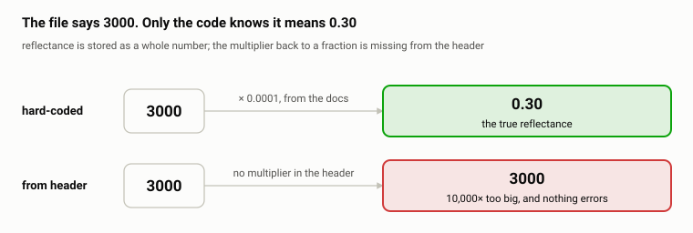

*the scale-factor trap · one stored number, two readings*

Reflectance is a fraction between 0 and 1, but the file stores whole numbers to save space:
0.30 is written as `3000`, and you multiply by 0.0001 to get the fraction back. That
multiplier belongs in the file's header. NASA left it out of some real HLS files — it is
item #7 on their published known-issues list, and it was never fixed.

So this pipeline never asks the header. The 0.0001 is written into the code, taken from the
documentation. And the fake file has no multiplier in its header on purpose: if anyone ever
changes the loader to read it from the file, the tests break that day.

Three smaller traps are planted the same way — the true grid origin rather than a tidy
made-up one, two different markers for missing data (−9999 for reflectance, 40000 for
angles) so both decode paths run, and every cloud-mask flag that matters. The planted
values give an NDVI of exactly 0.714285…, so the test asserts a number instead of
eyeballing one.

**The cloud mask, against NASA's own decoding.** AppEEARS decodes the quality bits
independently. Ours agrees with theirs on **100.0000% of 108,949 observations**, every bit.
One discovery along the way: 236 rows are no-data, and AppEEARS decodes those as "every
flag set" rather than as missing.

**The sun angles, against physics.** The satellite reports where the sun was; we recomputed
it from astronomy. Median disagreement **+0.31°**, with only 2.8% of acquisitions off by
more than a degree.

Fifteen findings are recomputed from the files on every run, and the findings document is
rewritten with whatever the numbers actually are. A claim that stops being true stops
appearing.

## How wrong is each measurement?

The usual way to check a satellite is to compare it against the ground and treat the ground
as correct. That catches gross errors, but it assigns *all* remaining disagreement to the
satellite — and the ground instrument here is five readings under a dark canopy at dusk.

**Triple collocation** avoids picking a winner. Each of three measurements is the truth plus
its own private error. Compare any two: the truth lines up, because it is the same truth in
both, but the errors do not, and over enough observations they cancel. So pairing any two
gives a clean read on the shared signal — and a measurement's own spread minus that shared
signal is its own error. You never need to know what the truth was.

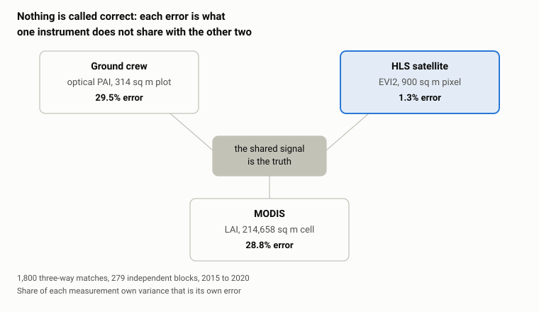

*triple collocation · 3 instruments, no referee*

Written out, for the ground:

```
var(error_ground) = Var(ground) − Cov(ground,HLS) × Cov(ground,MODIS) / Cov(HLS,MODIS)
```

**This is the only role MODIS plays in the project** — it is the required third measurement,
not a candidate model input. And because many plots share a MODIS cell on a given date, the
honest sample size is 279 independent blocks, not 1,800; every confidence interval is
computed on blocks.

**The caveat that must travel with that number.** Triple collocation charges each system
with everything it does not share with the other two. Look again at the footprints: every
genuine difference between what a 10-meter circle sees and what a 500-meter cell sees lands
in "ground error" by construction. So 29.5% is **disagreement with the larger footprints**,
not a verdict on the field crew's instrument. Separating the two is possible in principle
and was not done here.

**One assumption is known to be false.** The method needs the three error sources to be
independent, but Landsat and Sentinel-2 share optical physics, similar bands and similar
atmospheric correction. Rather than claim a fix, the code sweeps the unknown shared-error
fraction and reports where the answer moves: as shared error rises, estimated ground error
*falls* (0.759 to 0.481 PAI at a 20% share), and above 30% it goes negative, which is
physically impossible. That gives a hard upper bound.

**The usable deliverable** is a per-observation error bar on every satellite value: ±0.0145
EVI2 for Landsat, ±0.0227 for Sentinel-2. Sentinel-2 is 1.6× noisier.

## Matching ground to satellite

The ground crew visits on days of their choosing; the satellite passes on days of its own.
They rarely coincide.

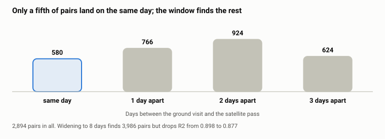

*how far apart the paired readings are*

Each ground reading takes the nearest satellite pass within ±3 days, and no satellite
observation is used twice. Only measurements from 2015 onward are used: the ground
instrument was replaced that year, and spanning the change would mix two calibrations.

**Result: 2,894 matched pairs, 37 plots, 92 field campaigns, 2015-07-13 to 2025-11-20.**

## Building the model

The model is **ridge regression** — a straight-line fit with a penalty that stops any one
input from dominating. Not a neural network, not a random forest. Under honest scoring a
random forest did *worse* (0.866 against 0.898), because a forest can memorize date-specific
patterns that do not generalize.

**How it is scored honestly.** Five-fold cross-validation where the folds are grouped by
*field campaign*, not by row. Two dates from the same field trip are one sampling occasion
and must not land on opposite sides of a train/test split. Every number below comes from
data the model never saw during training.

Rather than report one number, every run scores a whole ladder of models, so you can see
what each ingredient buys:

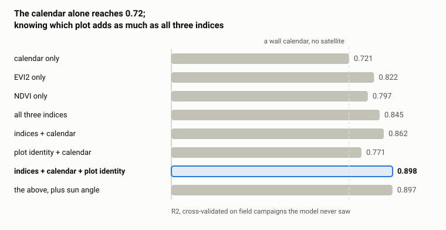

*the model ladder · what each ingredient buys*

Three things that chart says:

1. **The calendar alone gets you 72%.** A wall calendar with no satellite at all predicts
   leaf area in a deciduous forest surprisingly well, because leaves come and go on
   schedule. Any honest claim about satellite skill has to be measured against this, not
   against zero.
2. **Plot identity is worth as much as the spectra.** Knowing *which* plot you are standing
   in — one fixed offset per plot — adds as much as all three satellite indices combined.
   Some plots simply hold more leaf than others, consistently.
3. **Sun angle adds nothing.** More on that below.

The chosen model is **indices + calendar + plot identity: R² 0.898, RMSE 0.411 LAI units**.

## Where the model works and where it fails

The pooled score hides the interesting part.

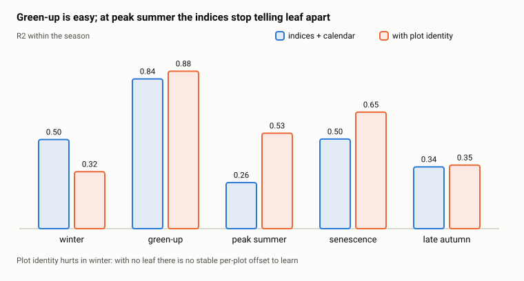

*skill by season, with and without plot identity*

**The model is excellent during green-up and weak at peak summer.** The reason is physical:
once the canopy closes, adding more leaf barely changes the reflectance — the indices
*saturate*. From above, four layers of leaf and five layers of leaf look nearly the same.

One more structural fact: **86.5% of the variance in leaf area is between dates**, and only
13.5% is between plots on the same date. The model is mostly doing seasonal timing, with a
modest per-plot adjustment on top.

## Forecasting ahead

The model above needs the satellite pass for the day it is predicting, so it can only fill
in dates already observed. A separate question: given everything known *h* days ago, what is
the leaf area today?

This uses a hard cutoff — only satellite observations dated on or before `today − h` are
admissible. Day-of-year is still allowed, because a calendar is legitimately known
arbitrarily far ahead. That also makes the calendar the baseline to beat. The harder
reference is **persistence**: run the retrieval on the last available pass and carry that
value forward, the honest "nothing has changed since we last looked" answer.

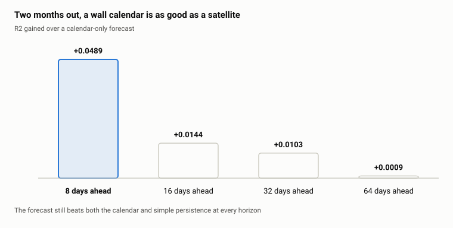

*what the satellite adds over a calendar, by horizon*

## The sun angle question

The solar zenith angle is how far the sun sits from straight overhead. The original Harvard
Forest authors explicitly invited someone to investigate whether it biases this kind of
record. Two different questions got tangled together here, and both answers are true.

**Does sun angle help predict leaf area?** No. Adding it moves R² from 0.8977 to 0.8971 —
slightly *worse*. At a fixed latitude with a fixed overpass time, sun angle *is* the
calendar, and the model already has the calendar.

**Does sun angle bias what the satellite reads?** Enormously. At the same measured ground
leaf area, spring EVI2 runs higher than autumn EVI2 — by 0.029 to 0.110 across five
leaf-area bins.

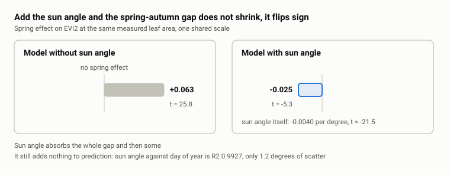

*the spring effect, before and after sun angle*

One caution, found while checking this for the report: the leaf-area × sun-angle interaction
is strongly significant over the full angle range (t = −15.0) but **vanishes inside the
24–40° band where spring and autumn overlap** (t = 0.34). That suggests the interaction may
be an artifact of the two seasons covering different angle ranges rather than real
curvature. It needs the restricted-range version before anyone should believe it.

**What this means together:** the model works, but for a physically wrong reason. It uses
the calendar as a stand-in for illumination geometry and has no idea that is what it is
doing. At this one site that is harmless. Move to a different latitude, a different overpass
time, or a sensor whose acquisition time drifts, and the calendar shortcut breaks while a
sun-angle correction would keep working.

## What we know is weak

Stated plainly, because these are the things a reader should not be surprised by later. The
biggest one is that neither reported score covers the hard case:

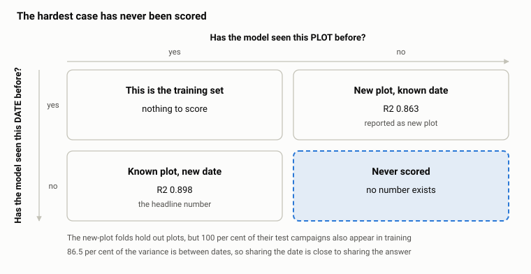

*which generalization cases have a number · one is empty*

The rest:

- **The target is derived, not measured.** Everything predicts PAI-minus-plot-minimum, not
  measured leaf area. Encouragingly, modeling raw PAI instead gives essentially identical
  error (RMSE 0.4114 against 0.4111) once plot identity is in the model — the subtraction is
  largely absorbed by the per-plot offsets. But the target remains an estimate.
- **The satellite record covers 40 plots, not 46.** The six harvest plots were never ordered
  from AppEEARS. They are absent by omission rather than by masking, and nothing documents
  this as a deliberate scope decision.
- **The uncertainty estimate is computed and then ignored.** The per-observation error bar
  from triple collocation is written into the satellite file and loaded by the modeling code
  — and never used as a weight, a feature, or anything else. It rides along as a passenger
  column.
- **One self-regenerating finding is wrong.** S1-13 reports that the high-aerosol rule costs
  55.5 points of the record. It costs 4.1. The calculation credits the rule with every
  high-aerosol pixel that was cloudy, shadowed or snow-covered anyway — 56,117 of the 60,580
  rows it counts. The conclusion survives; the magnitude does not.
- **Several code comments are stale.** Module docstrings in the reprocessing and modeling
  packages carry numbers from before the last data backfill and findings regeneration. The
  regenerated findings files and the output files agree with each other; the docstrings do
  not. Trust the findings files.
- **One acquisition record is incomplete.** The archived request file for the largest Landsat
  bundle (2015–2020, the entire comparison window) omits the quality mask from its layer
  list. The delivered data does contain it, so nothing is missing — but the provenance record
  does not match what arrived.
- **The main extraction step has no command.** Turning 109,185 pixel-rows into 46,200
  plot-rows was done by calling two functions from a notebook. There is no CLI entry point,
  so the most load-bearing step in the pipeline is reproducible only by hand.

## What is not done

- **The sun-angle study itself has not been written.** The numbers in this report were
  computed for it, but no module, notebook or output file implements it. In the original
  planning document it was ranked last of five options — explicitly invited by the source
  authors and the strongest hook, but also the hardest to implement and the most likely to
  be scooped. It currently exists as analysis, not as code.
- **The light-response study is blocked.** Its code runs and its findings reproduce, but it
  concluded that six point sensors under a closed canopy measure stray sunbeams rather than
  plot-average light. That is the wrong instrument for the question, and the study stops
  there. A finding, not a failure. See [`s4/`](../s4/FINDINGS.md).
- **The angle study is at notebook one of several** — data loaded and quality-checked, no
  analysis yet. See [`study2/`](../study2/README.md).
- **MODIS could be extended.** Its record stops at 2020-12-26, but that is a property of how
  the data was requested, not of the product itself. Nobody has checked whether later
  composites exist.
