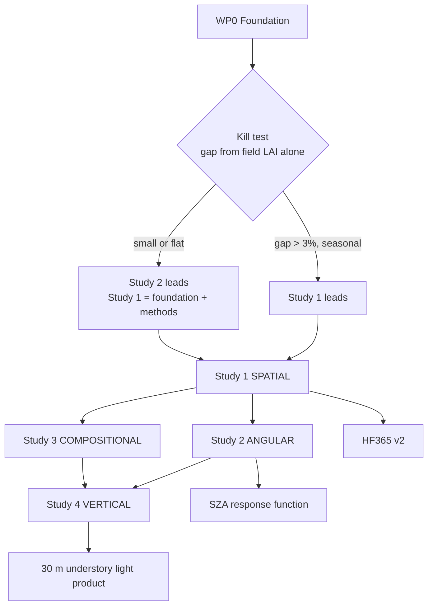

# Research program: what a pixel cannot see

**Repo:** `harvard-forest-spectral-modeling` · **Action:** `06-research-plan`
**Companions:** `01-data-catalog.md` (sources and links), `wp0_foundation.py` (foundation and kill test)

---

## 1. The thesis

A satellite pixel is a claim about an ecosystem, and every claim has an error term. Four distinct gaps separate what a pixel records from what the canopy is doing:

| Gap | The mismatch | Ground truth that exposes it |
|---|---|---|
| **Spatial** | One value applies a nonlinear function to a spatial mean | 40 plots inside 5 MODIS cells, measured for 30 years |
| **Angular** | One observation, at one solar zenith angle, per date | 30-minute below-canopy PAR at 6 named plots since 2008 |
| **Compositional** | One value blends species with different phenology | Litterfall sorted by species, per plot, since 1998 |
| **Vertical** | The sensor sees only the canopy top | Paired above and below canopy PAR |

Each gap is quantifiable **only** where ground truth exists on that axis. Harvard Forest is one of very few sites with ground truth on all four. Each gap, once quantified, yields a correction that transfers to sites without ground truth.

**Not four papers about a forest. One argument about satellite representation, tested four ways at the one place where all four tests are possible.**

---

## 2. The objection each study must survive

Every study here has an adjacent, obvious-sounding version that would be worthless. Naming the difference is what separates a contribution from a shrug.

| Study | The worthless version | The actual question |
|---|---|---|
| **1 Spatial** | "30 m resolves more than 500 m." Arithmetic, and already shown in the source paper's Figure 13 | Coarse products carry a bias arising from the *mathematics* of the retrieval, not its quality. Better sensors, atmospheric correction and algorithms cannot remove it. How large is it, where does it concentrate, and can it be corrected? |
| **2 Angular** | "fAPAR obviously depends on sun angle." Textbook | Does the operating model get the dependence *right*? Its own authors write that it does not, and nobody has tested the response function directly because that requires sub-daily below-canopy PAR |
| **3 Compositional** | "Mixed pixels obviously blend species." Definitional | Prior work could not separate species from topography. At a flat site topography is removed and every plot shares an identical sun angle, so composition is isolable for the first time |
| **4 Vertical** | "Satellites obviously cannot see under the canopy." Trivially true | Is the below-canopy light field *predictable* from above-canopy observation? If so it is a new product, and it addresses the driver radiative-transfer work ranks first |

**Write these into the papers.** A reviewer will reach for the left column. Answer it in the introduction rather than the rebuttal.

---

## 3. Study 1's claim, stated properly

This is the study most vulnerable to the shrug, so its argument has to be exact.

### 3.1 The bias is structural, not a quality problem

fAPAR is concave in LAI: `fAPAR = P∞(1 − exp(−kL))`, saturating above LAI near 2. Applying a concave function to a spatial mean is not the same as averaging the function. By Jensen's inequality:

```
E[f(L)]  <  f(E[L])
E[f(L)]  ≈  f(E[L])  −  ½ · P∞ k² exp(−k·E[L]) · Var(L)
```

**A perfect MODIS LAI retrieval still yields biased fAPAR.** The error does not shrink with better calibration, better atmospheric correction, or a better algorithm, because it is a property of the nonlinearity rather than of the measurement. Removing it requires sub-pixel `Var(L)`, which no improvement to a 500 m instrument can observe.

The claim is not "coarse is worse." It is: **there exists a class of error in coarse products that no amount of improving coarse products can address.** That is not what anyone means when they say higher resolution is better.

### 3.2 Why it still matters that HLS exists

MODIS runs from 2000; HLS starts 2013. Land surface models, carbon reanalyses and every trend study spanning more than a decade run on coarse LAI and FPAR, and will continue to, because the long record is the coarse record and VIIRS extends it. The question is not "should people use HLS" but "given that they run on coarse data, what correction applies." That is a product contribution, and it is the opposite of a resolution comparison.

### 3.3 The uncomfortable corollary

Validation protocols conventionally favour spatially homogeneous sites, precisely to make point-to-pixel comparison defensible. Homogeneity is also the condition under which this bias is smallest, since the bias scales with variance.

**Coarse products are therefore validated where the bias is minimal and applied where it is maximal.**

Harvard Forest, with 40 plots inside 5 cells, lets you measure the heterogeneity that validation site selection is designed to avoid. Check the CEOS Land Product Validation guidance before asserting the homogeneity convention in print.

### 3.4 The seasonality decides whether anyone cares

If the bias is constant it is absorbed into model calibration and nobody should care. If it concentrates in spring and fall it aliases onto phenology and growing-season-length signals, the most contested topic in this literature.

Two effects compound in that direction. The Taylor term carries `exp(−k·E[L])`, largest at low mean LAI. And `Var(L)` is itself largest during green-up and senescence, when plots transition at different rates, and smallest mid-season when every plot saturates. **Both terms peak in the shoulder seasons.**

Nobody has measured this, because it requires sub-pixel LAI variance at 8-day resolution against ground truth.

### 3.5 The registration result, which involves no MODIS at all

Independent of everything above:

| Quantity | Value |
|---|---|
| Plots wholly inside one HLS pixel | 7 of 40 (18 %) |
| Plots straddling a boundary | 33 of 40 (82 %) |
| Plots touching four pixels | 12 |
| **Overlap fraction in the assigned pixel** | **median 0.76, min 0.37, max 1.00** |

Quote 0.76, not 0.82. "82 percent straddle" is a headline; "the median plot contributes only 76 percent of its area to the pixel it is validated against, and the worst contributes 37 percent" is the quantity that propagates into validation error.

This is a critique of validation methodology itself. It applies to a large body of published LAI and fAPAR validation, including the R² values in the source paper. It may be the stronger of Study 1's two contributions.

### 3.6 Kill criterion, testable this week

**Run `wp0_foundation.py --killtest` before committing.** It computes the gap from `hf069-01` field LAI alone. No satellite data, no downloads beyond one CSV.

| Result | Consequence |
|---|---|
| Gap > 3 % somewhere, with clear shoulder-season structure | Study 1 leads the program |
| Gap 1-3 % with seasonal structure | Study 1 is a solid secondary result; Study 2 leads |
| Gap < 1 %, or flat across the season | **The headline dies.** Study 1 reduces to registration plus HF365 v2, both still publishable, and Study 2 leads |

Losing the headline is survivable. Only two of five MODIS cells have enough active plots to estimate variance (n = 12 and n = 11); one is marginal (n = 6) and two are unusable (n = 3, n = 2). Bootstrap, report intervals, state n in the abstract.

---

## 4. Execution order versus narrative order

They are not the same, and conflating them is how plans go wrong.

**Execution order is fixed: 1 → 2 → 3 → 4.** Study 1 runs first regardless, because every downstream study needs correct plot-to-pixel values and the reprocessed dataset. True even if Study 1's headline dies.

**Narrative order is decided by the kill test.** If the gap is large and seasonal, Study 1 leads. If not, Study 2 leads and Study 1 becomes foundation plus a methods contribution.

Study 2 has no version of this vulnerability. Nobody says "obviously fAPAR depends on sun angle, why bother," because the question is whether the operating model gets it right, and its own authors wrote that it does not.



---

## 5. WP0 Foundation

Two to three weeks. Run `wp0_foundation.py`.

**Recover bands from HF365.** The archive holds three indices, not bands, and the whole argument runs through NIR. They invert exactly: `NIR = NIRv/NDVI`, then `RED = NIR(1−NDVI)/(1+NDVI)`. Verify by recomputing EVI2. Values are stored to 0.001 so the division destabilises as NDVI approaches zero; trustworthy through the growing season, noisy at leaf-off. Resolve the 261 versus 262 record mismatch between `hf365-01` and `hf365-02`.

**Plot registry and crosswalks.** Complete, from HF375-02 coordinates. Measured geometry: 8 transects, one per letter A to H, bearings 205° to 309° in a 104° cone from SW to NW, distances 31 to 484 m. This contradicts both published descriptions, which say six transects and 36 plots (paper) and ten transects and 40 plots (HF069); the 34-degree gap between transects D and E, against about 11 degrees elsewhere, is consistent with a ten-transect design in which two were never populated. Active set is 34 plots: G3, H3 and H4 dropped in 2001 to beaver-pond inundation, A4, A5 and B5 moved to the harvest group.

**Solar geometry.** SZA, azimuth and clear-sky PAR at 30 minutes, 2008 to present, via `pvlib`. Cross-check against the HLS `SZA` band. Derive clearness index and diffuse fraction; check HF249 and `hf206-02` first for a direct diffuse measurement.

**Canonical fAPAR table**, reproducing equations 3, 8 and 9 with the paper's filters. **Equation 8 as printed reads `fAPAR_C = P∞ − exp(−K_μL)`, returning −0.06 at L = 0.** The intended form is almost certainly `P∞(1 − exp(−K_μL))`. Confirm against the published version.

**Mandatory QC on hf206-05:** unconverted ±7999 Campbell sentinels in `par_f2_max` and `swc3_max`; large negative PAR (`par_c3_min` = −1648); impossible temperatures (`tsoil2_e` max 101.8 °C, `tair_us_e_20cm` max 88.5 °C); `swc4_max` = 1.578 above the physical maximum. Small negative `_ave` minima near −3 are normal sensor zero-offset: clamp, do not discard. `par_*_max` are labelled dimensionless in the EML, which is wrong. The `_ave` descriptions assign all six sensors to EMS1 while the methods and `_max` descriptions assign E3, F3, F2 to EMS2; trust the methods.

**Reproduce the published tables.** LAI R² 0.72 / 0.79 / 0.79; instantaneous fAPAR_C R² 0.84 to 0.89; daily APAR R² 0.90 to 0.95. Failure to reproduce is itself a finding.

**Gate.** Proceed if the inversion reproduces EVI2 to within rounding and two of four tables reproduce.

---

## 6. Study 1 · SPATIAL

Claim and kill criterion in section 3. Method here.

**Step 1, registration.** Compute both the single-pixel value (the archive's convention) and the area-weighted value across all touched pixels. Correlate each against field LAI. **No new data required. Fastest defensible result in the program.**

**Step 2, the gap.** Per cell per 8-day window, compute `Var(L)` three ways: from field plots (truth), from HLS-derived 30 m LAI (satellite estimate), from a model on MODIS-observable inputs (transferable). Truth against satellite validates the estimate; satellite against model validates transfer. Compute the exact gap and cross-check against the second-order approximation; divergence means the LAI distribution is skewed enough that the Taylor expansion fails, which is reportable.

**Step 3, the model.** Predict the conditional *distribution* of 30 m LAI given MODIS inputs. The generative framing is not decoration: the variance the model outputs is literally the term in the bias equation, so a mean-only model cannot answer the question. Ascending ambition: mixture density network, conditional normalising flow, conditional diffusion for 500 m to 30 m, fine-tuned Prithvi-EO-2.0 (600M parameters, pre-trained on 4.2M global HLS samples at 30 m) via TerraTorch. Evaluate **calibration of the predicted variance** with CRPS and PIT histograms, not RMSE of the mean. Baselines: zero sub-pixel variance (current implicit practice), one fitted variance per season, mean-only regression.

**Step 4, transfer.** Tier 1 calibrates where truth exists. Tier 2 applies the relationship to arbitrary MODIS and HLS pairs carrying Harvard-derived uncertainty. Portability is then earned rather than assumed.

**Deliverable: HF365 v2.** The archive was built on HLS v1.4, which is retired.

| | HF365 v.3 | Reprocessed |
|---|---|---|
| Source | HLS v1.4, retired | HLS v2.0, current |
| Span | 2015-2020 | 2015 to present |
| Content | 3 indices | 3 indices **plus red, NIR and all bands** |
| Geometry | none | **per-observation solar and view angles** |
| QA | undocumented NA reasons | explicit Fmask bit provenance |
| Assignment | single containing pixel | single pixel **plus area-weighted** |

Requires the original lead's sign-off to publish as a new version. Validate against archived HF365 over 2015-2020 and **report the disagreement**, which is the evidence the reprocessing was worth doing.

Caveat: MODIS LAI is systematically higher than HLS-derived LAI here, so comparisons superimpose a level offset on the scaling gap. Separate them or say you have not.

---

## 7. Study 2 · ANGULAR

**Question.** Does canopy light absorption respond to solar zenith angle the way the operating model predicts, and how much of the observed seasonal index decline is illumination geometry rather than canopy change?

**Why it is identifiable here and almost nowhere else.** Within a single day, SZA sweeps tens of degrees while LAI, leaf angle, chlorophyll, species composition, understory state and canopy structure are physically constant. Not statistically adjusted. Constant. At 42.54°N, solar noon on the summer solstice puts SZA near 19°, and 7 AM that same day puts it near 64°, which is also roughly solar noon on 1 December. **A July morning and a December midday sample identical illumination through radically different canopies.** Sample size is roughly 20 half-hourly observations per day, 230 growing-season days, 17 years, six instrumented plots.

FT04 predicts SZA dependence explicitly through its `G(θ)/cos θ` path-length term. The published work validated the model's aggregate output. Nobody has tested the response function itself, because that requires continuous sub-daily below-canopy PAR. The original authors state the gap: correcting the spring and fall high-SZA bias is important future work.

**Hypotheses.** H2.1: the empirical response, conditioned on LAI and diffuse fraction, deviates systematically from FT04, and the deviation grows at high SZA. H2.2: fAPAR at matched SZA differs between diurnal and seasonal sampling of that angle, and the difference is canopy change with geometry removed. H2.3: the response is weaker under high diffuse fraction, isolating direct-beam shadowing.

**Inputs.** `hf206-05-EMS-understory.csv`: 302,777 rows, 30-minute resolution, 2008-01-01 to 2025-01-09, essentially gap-free at the row level. The six PAR sensors sit inside named biometry plots that are also HF365 columns and hf069 rows:

| Plot | Logger | Missing | Wholly inside its HLS pixel? | MODIS cell |
|---|---|---|---|---|
| C2 | EMS1 | **1.4 %** | no | pixel_4 |
| E3 | EMS2 | **1.4 %** | **yes** | pixel_1 |
| B2 | EMS1 | **1.6 %** | no | pixel_4 |
| F3 | EMS2 | 7.6 % | no | pixel_1 |
| F2 | EMS2 | 11.0 % | no | pixel_1 |
| C3 | EMS1 | 12.1 % | no | pixel_4 |

**E3 is the only PAR plot wholly inside its pixel**, so it is the cleanest single-plot case. The two loggers fall in different MODIS cells, enabling a cross-footprint comparison with independent instrumentation. Use B2, C2, E3 as primary and the rest as replication. Above-canopy PAR, which this file lacks, comes from HF004 and HF282; **verify their continuity across 2015-2020 before committing.** The `_ave`, `_max`, `_min` triplet gives within-interval variability free, a direct sunfleck measure.

**Method.** Baseline is FT04 unmodified, which you are characterising rather than merely beating. Primary model is a GAM or monotonic-constrained network on `(SZA, LAI, diffuse fraction, VPD, DOY)` so the marginal SZA response is readable and plottable against FT04's curve. **The deliverable is a curve, not a score.** Matched-pair estimation for H2.2, pairing observations at SZA matched within 1° and diffuse fraction matched, differing in DOY; assumption-light and the one to trust on disagreement. Per plot then pooled. Optional symbolic regression to recover a closed-form correction comparable to equations 5 to 7.

**Validity checks, not optional.** Run the identical estimator with red-band reflectance as the outcome. The mechanism predicts a null, because leaves absorb strongly in the visible. A large red-band effect means the pipeline is broken and you report that instead. **Put this in the abstract, not the supplement.** Separately, estimate the effect on NDVI and EVI2: published BRDF work at this site finds they move in opposite directions under increasing SZA, and reproducing that divergence is strong evidence you are capturing illumination physics rather than a seasonal trend proxy. Block cross-validation by year and day; consecutive half-hours are near-identical so random splitting leaks catastrophically.

**A corollary worth stating.** The satellite only ever observes clear pixels, because cloudy ones are masked. So satellite greendown is measured entirely under the illumination regime where shadowing is strongest. That follows directly from the data and does not appear to have been stated.

**Weaknesses.** Point sensors in a sunfleck-dominated field; thin spatial sampling even after 30-minute averaging. All six in one footprint, so this is one canopy's response function. Diffuse fraction derived unless HF249 provides it.

**Kill criterion.** If the negative control fails, Study 2 becomes a methodological note on identification and the program leans on Studies 1 and 3.

---

## 8. Study 3 · COMPOSITIONAL

**Question.** Does species composition explain plot-to-plot greendown at a topographically flat site, and is composition recoverable from index time-series shape?

**The control.** All 40 plots lie within 484 m of the tower, so on any date they share an essentially identical solar zenith angle. **Cross-plot variation in greendown is SZA-free by construction**, with no statistical adjustment. The exact inverse of Study 2's design. Prior work attributed roughly half of greendown spatial variation to species plus topography without separating them; a flat site removes topography.

**The labels almost nobody has.** `hf069-05-litter.csv` records litterfall sorted by species, per plot, annually since 1998. `hf069-09-ems-trees.csv` gives tree-level species and DBH per plot. Every 30 m pixel has known composition including the deciduous-versus-evergreen split, since hemlock and white pine are present.

**Hypotheses.** H3.1: per-plot greendown slope varies significantly across plots despite identical illumination. H3.2: that variation is predicted by composition, evergreen fraction dominant. H3.3: species fractions are recoverable from time-series shape, because each species has distinct phenological timing and greendown slope.

**Method.** Features are the full index series (roughly 44 dates) for three indices plus recovered NIR and red, per plot per year. Prefer a learned representation from a 1D CNN or time-series transformer over hand-engineered phenometrics. Target continuous species fractions from litterfall mass, not hard classes. **Leave-one-plot-out cross-validation, mandatory**, with 34 to 40 labels. Test transect identity as a covariate before reaching for species, since the eight transects encode direction and edge proximity. The six PAR-instrumented plots give measured light transmission to check inferences against.

**Limitation.** 40 plots is a small label set. Compensate with the roughly 260-date feature dimension, per-year replication, and bootstrap intervals. No generalisation claims beyond this site.

**Kill criterion.** H3.1 alone is publishable even if H3.2 and H3.3 fail, since significant SZA-free spatial variation in greendown at a flat site is itself a constraint on the mechanism.

---

## 9. Study 4 · VERTICAL

**Question.** Can the below-canopy light regime be generated from above-canopy satellite observation?

**Why it matters.** Understory light is a first-order control on seedling survival, regeneration and understory phenology. Radiative-transfer work ranks understory reflectance decline as the largest single contributor to seasonal NIR decline, around 43 percent, ahead of leaf angle at 31 percent and solar zenith angle at 21 percent. If that ranking holds, Study 2's mechanism is not dominant, and this is where the dominant one becomes measurable.

**Why generative is correct here.** Sunflecks make below-canopy light heavy-tailed in space and time, and the ecologically important statistic is the tail, since seedling survival depends on peak exposure rather than mean irradiance. A model outputting a mean answers the wrong question. The `_ave`, `_max`, `_min` triplet gives a coarse three-point summary of the within-interval distribution to train against.

**Method.** Train on paired above and below canopy PAR from `hf206-05`, HF282, HF183 and NEON DP1.00024.001, conditioned on HF365 indices, SZA, diffuse fraction, LAI and Study 3's composition. Mixture density network as the working baseline, then conditional flow or diffusion over the diurnal curve. Optionally fine-tune Prithvi-EO-2.0 as the encoder.

**Reframe the target to control the central risk.** Predict the distribution **at a known 30 m pixel**, not a spatial field. Six sensors sit inside six named plots with known pixel assignments, so this is point-to-pixel, not point-to-field. Use the NEON canopy height model and lidar gap fraction as spatial covariates. Validate on held-out sensors and held-out years, never held-out timestamps.

**Risk.** Highest in the program. Be explicit that the model predicts the distribution a sensor would see, not a mapped field, unless demonstrated otherwise.

---

## 10. How the studies combine

The synthesis, and the strongest single argument available:

1. **Study 1** quantifies the structural aggregation bias and produces a corrected 30 m dataset with geometry.
2. **Study 2** uses it to show how much residual seasonal signal is illumination rather than canopy, via a within-day natural experiment.
3. **Study 3** independently bounds the canopy contribution via a cross-plot natural experiment with illumination held fixed.
4. **Studies 2 and 3 must agree.** If geometry explains X percent and composition explains Y percent, then X + Y should approximate total observed greendown. If it does, two independent quasi-experimental designs have corroborated a decomposition. If it falls short, the remainder is the understory term, which is exactly what **Study 4** predicts and measures.

Two independent designs converging on a decomposition, with the residual assigned to a fourth mechanism that is then measured directly.

**Carbon consequence, as the closing section.** The published work estimates that 10 days earlier greenup adds 83.7 g C m⁻² to spring GPP, a 22.8 percent spring and 5.6 percent annual increase, from long-term means and described by its authors as approximate. Recompute with corrected fAPAR and validate against tower GPP from AmeriFlux US-Ha1. If the correction moves those numbers that is the headline; if not, the null is publishable and useful, because it says the artefacts do not propagate to carbon-budget conclusions.

---

## 11. Schedule

| Phase | Weeks | Output | Folder |
|---|---|---|---|
| **Kill test** | **1 day** | **Gap from field LAI alone; decides narrative order** | `12-scaling-bias` |
| WP0 foundation | 1-3 | Band recovery, fAPAR table, reproduced tables | `01-data-understanding`, `07-hls-recreation`, `08-solar-geometry` |
| HLS v2.0 retrieval, AOI S3 | 1-2, parallel | Bands, angles, Fmask | `07-hls-recreation` |
| Study 1 registration result | 3-4 | Single-pixel vs area-weighted against field LAI | `12-scaling-bias` |
| Study 1 full | 4-9 | Gap, distributional model, **HF365 v2** | `12-scaling-bias` |
| Study 2 | 9-17 | Empirical SZA response function | `09-sza-response` |
| Study 3 | 12-18, parallel | Composition and greendown | `10-species-greendown` |
| Synthesis and carbon | 18-22 | Decomposition closure, GPP recomputation | `13-synthesis` |
| Study 4 | 22+ | Understory light product | `11-understory-light` |

Rename `05-lai-fapar-forecasting` to cloud-gap nowcasting. Interannual forecasting is not viable: 2015-2020 contains only 6 days of spring and 8 days of fall phenological range, so there is no interannual signal. Within-season gap-filling is well-posed, since roughly half of growing-season HLS observations are lost to cloud and the penalised spline is a real baseline.

---

## 12. Kill criteria and gates

| After | Proceed if | Otherwise |
|---|---|---|
| **Kill test** | Gap > 3 % with shoulder-season structure | Study 2 leads; Study 1 keeps registration + HF365 v2 |
| WP0 | Inversion reproduces EVI2; two of four tables reproduce | Diagnose archive inconsistency and report it |
| Study 1 step 1 | Either assignment correlates acceptably with field LAI | Registration broken; investigate coordinates |
| Study 1 | Always proceed; outputs feed downstream | Report the null, ship HF365 v2 |
| Study 2 | Negative control returns null; response stable across 3+ plots | Report as an identification note |
| Study 3 | H3.1 holds | Still reportable as a bound |
| Synthesis | X + Y approximates total greendown | The residual becomes Study 4's motivation |

---

## 13. Risk register

| Risk | Affects | Mitigation |
|---|---|---|
| **The "so what" critique** | 1 | Sections 2 and 3. Lead with structural irreducibility, not resolution |
| Gap turns out small and flat | 1 | Kill test first, one day, before any commitment |
| Above-canopy PAR gaps in HF282, HF004 | 2, 4 | **Verify before committing.** Three sources give partial redundancy |
| Equation 8 typo | 1, 2, 4 | Confirm against the published version before coding |
| Sentinel values corrupt the fAPAR table | 2, 4 | Section 5 filters, applied in WP0 |
| Landsat `B05` vs Sentinel-2 `B8A` NIR | all | Using `B08` injects a bandpass step that mimics real signal |
| Pixel index offset vs tile-relative row/col | all | Read `ULX`/`ULY` from a T18TYN granule; crosswalk centre lat/lon is unambiguous |
| Only n = 12 and n = 11 usable MODIS cells | 1 | Bootstrap, report intervals, state n in the abstract |
| 82 % of plots straddle boundaries | all | Report both assignments; the gap is a result |
| 40 plots is a small label set | 3 | Leave-one-plot-out, continuous targets, no generalisation claims |
| Point sensors will not generalise to a field | 4 | Predict sensor-level distribution at a known pixel |
| Random CV inflates every score | all | Block by year, plot and day; report both |
| HLS v2.0 disagrees with archived HF365 | 1 | That disagreement is a result, not a failure |

---

## 14. Immediate actions

1. **Run the kill test.** `python wp0_foundation.py --killtest`. One CSV, one day, decides what the program leads with
2. Run `wp0_foundation.py` for band recovery and the area-weighted join
3. Submit the AppEEARS request for AOI S3: `HLSL30.020` and `HLSS30.020` **with the angle bands**, plus `MCD15A2H.061`, `MCD43A1.061`, `MCD43A4.061` on the 20-cell block
4. Download HF206, HF282, HF004 and verify above-canopy PAR continuity across 2015-2020
5. Produce Study 1 step 1: single-pixel versus area-weighted against field LAI. No new data required
6. Fetch HARV_049 and HARV_050 coordinates from the NEON portal
7. Email `hf-im@lists.fas.harvard.edu` reporting the ±7999 sentinels, the EML unit errors on `par_*_max`, the datalogger attribution inconsistency, and the transect-count discrepancy. Four concrete archive corrections, and a natural reason to be in contact
